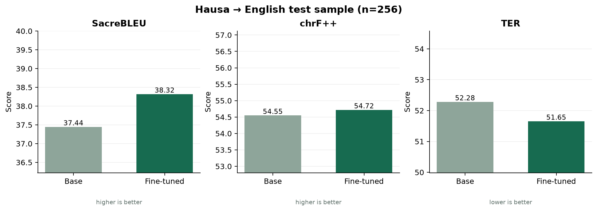

# Experimental results

## Run and split summary

- **Run sample:** 3,000 training pairs, 256 validation pairs and 256 held-out test pairs.
- **Available processed corpus:** 295,811 unique pairs; train 237,325, validation 29,400, test 29,086.
- **Selection:** checkpoint with lowest validation loss; the test split was not used for parameter updates or checkpoint selection.
- **Decoding:** beam search, `Helsinki-NLP/opus-mt-ha-en` base checkpoint.
- **Seed:** 42.

## Same-sample model comparison

| Metric | Base model | Fine-tuned | Fine-tuned − base | Direction |
| --- | ---: | ---: | ---: | --- |
| SacreBLEU | 37.4445 | 38.3172 | +0.8727 | Higher is better |
| chrF++ | 54.5478 | 54.7170 | +0.1692 | Higher is better |
| TER | 52.2801 | 51.6519 | -0.6282 | Lower is better |

Exact-match rate: base **0.0391**, fine-tuned **0.0508**.

Before scoring, Moses English detokenization is applied in the same way to hypotheses and references because MT560 punctuation is whitespace-tokenized. SacreBLEU and chrF++ are higher-is-better corpus scores; TER is lower-is-better. The corpus-level measurements may change with the evaluation subset, tokenization signature and software versions; see `artifacts/test_metrics.json` for full metric signatures and elapsed time.

## Interpretation limits

The reported test is a deterministic, bounded sample from an internal 10% partition of the MT560-derived corpus. The partition keeps identical Hausa source strings together, but the dataset mirror does not provide document provenance. Helsinki OPUS-MT was trained on OPUS material and MT560 is an OPUS-aggregated collection, so overlap with the pretrained model's training data cannot be ruled out. The corpus is heterogeneous and domain-skewed; the scores are not independent benchmark results and must not be generalized to other domains or all Hausa speakers. No bilingual human evaluation has been performed. A metric increase does not guarantee preserved meaning.

The complete example-level outputs and actual model/run metadata are in `../artifacts/test_predictions.csv` and `../artifacts/model_metadata.json`.
